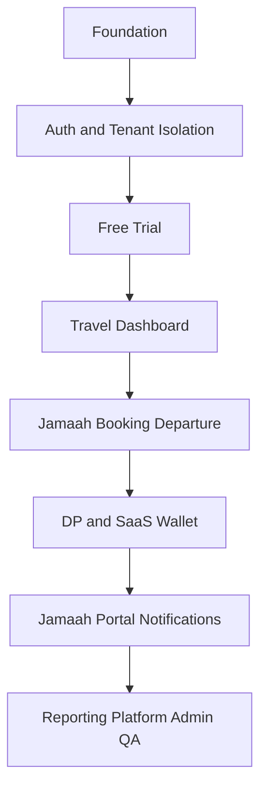

# UMROVIA — DEVELOPMENT ROADMAP

**Versi:** 1.0 | **Tanggal:** 21 Oktober 2026 | **Status:** Baseline perencanaan MVP

**Dokumen rujukan:** `PRD_Umrovia_SaaS_v3_5_Development_Roadmap.md` dan `PRODUCT_SPEC_Umrovia_SaaS_v1_2_Development_Plan.md`.

## 1. Prinsip dan target
- Fokus satu developer; estimasi total **19 minggu** berurutan, bukan jaminan atau komitmen tanggal rilis.
- Product decisions tetap: SaaS Pay-per-Jamaah Rp50.000 per booking-jamaah setelah DP diverifikasi; gratis bulanan/setup; trial 30 hari, 20 data dummy dan 3 user internal.
- P0 domain: marketing, tenant dashboard, admin console dan API; vanity subdomain P1.
- Gunakan staging, test tenant escape, replay webhook dan restore drill sebelum pilot.
- Semua pekerjaan memakai status `TODO`, `IN_PROGRESS`, `BLOCKED`, `IN_REVIEW`, `DONE` dan ditautkan ke issue/PR.

## 2. Roadmap fase

| Fase | Fokus | Durasi estimasi | Deliverable / exit gate | Prioritas |
|---|---|---:|---|---|
| F01 | Fondasi proyek | 1 minggu | Aplikasi dan API bootstrapped secara lokal; CI lint/test berjalan; migrasi baseline berhasil | P0 |
| F02 | Authentication dan Multi-Tenancy | 2 minggu | Dua tenant tidak dapat membaca/mengubah data satu sama lain; login/reset/logout berfungsi | P0 |
| F03 | Free Trial | 1 minggu | Trial berakhir tanpa tagihan; konversi Active tidak memigrasikan transaksi DEMO ke produksi | P0 |
| F04 | Dashboard & pengaturan travel | 2 minggu | Tenant owner mengelola staf dan profil dengan audit; user tanpa izin ditolak | P0 |
| F05 | Operasional inti travel | 4 minggu | Pendaftaran jamaah berhasil; seat count aman dari overbooking; manifest dapat dibuat | P0 |
| F06 | Pembayaran jamaah & SaaS Wallet | 3 minggu | DP terverifikasi memicu tepat satu debit; saldo tidak cukup menghasilkan pending_charge; ledger rekonsiliasi | P0 |
| F07 | Portal, manifest & notifikasi | 3 minggu | Jamaah hanya mengakses datanya; upload aman; email berbasis event dikirim terpantau | P0 |
| F08 | Laporan, Platform Admin & hardening | 3 minggu | Laporan rekonsiliasi akurat; akses admin terpisah/MFA; backup-restore diuji; pilot layak go-live | P0 |


## 3. Kalender sprint usulan (19 minggu)

| Sprint | Minggu | Fokus | Artefak / quality gate | Status |
|---|---:|---|---|---|
| S01 | 1 | Bootstrapping monorepo, Docker, backend/frontend health, CI | Local stack reproducible, migration pass | TODO |
| S02 | 2 | Identity, signup, email verification, membership | Auth flows tested | TODO |
| S03 | 3 | Tenant resolver, RBAC, RLS, security tests | Cross-tenant access denied | TODO |
| S04 | 4 | Trial lifecycle, demo data, quotas, expiry | Trial → active without auto-charge | TODO |
| S05 | 5 | Travel profile, staff, roles, bank accounts | RBAC and audit passes | TODO |
| S06 | 6 | Tenant dashboard, config, template basics | Tenant admin demo accepted | TODO |
| S07 | 7 | Jamaah master and secured document model | CRUD, duplicate handling, isolation | TODO |
| S08 | 8 | Packages, departures, seat allocation | Capacity concurrency tests | TODO |
| S09 | 9 | Booking status, linking pilgrims to departures | Booking end-to-end | TODO |
| S10 | 10 | Manifest base and operational checklist | Basic departure manifests export | TODO |
| S11 | 11 | Invoice/receipt models, DP verification | Payment state machine tests | TODO |
| S12 | 12 | Prepaid wallet, top-ups, immutable ledger | Reconciliation and atomic debit tests | TODO |
| S13 | 13 | Billing event flow, insufficient wallet, refunds | Exactly-once charge + ledger consistency | TODO |
| S14 | 14 | Jamaah portal, auth, profile/doc upload | Object-level permissions | TODO |
| S15 | 15 | Departure operations, manifests, PDF exports | Operational UAT | TODO |
| S16 | 16 | Email notifications, retries, templates | Queue/idempotency tests | TODO |
| S17 | 17 | Ready reports: operational, finance, usage | Reconciliation vs primary records | TODO |
| S18 | 18 | Platform control plane, tenant lifecycle, support | Admin MFA/audit, no PII leakage | TODO |
| S19 | 19 | Security/load/UAT, backup+restore, staging pilot | MVP release gates signed | TODO |

## 4. Sprint 1 — checklist rinci

| ID | Task | Dependensi | Acceptance criteria | Status |
|---|---|---|---|---|
| T01 | Repo + README + docs baseline | — | New developer can clone/bootstrap | TODO |
| T02 | Python/Node lockfiles, lint/typecheck | T01 | CI deterministic install | TODO |
| T03 | Docker Compose: postgres, redis, api, web | T02 | Services start and healthy | TODO |
| T04 | Django DRF health endpoint, settings split | T03 | GET /api/v1/health responds 200 | TODO |
| T05 | Custom User before migrations; base Tenant/Membership/Role | T04 | Clean migration succeeds | TODO |
| T06 | Tenant permission middleware design and test skeleton | T05 | Missing tenant denied; basic isolation test | TODO |
| T07 | Next.js app shell and registration layout | T02 | Responsive basic UI | TODO |
| T08 | GitHub Actions for lint/test | T02 | Checks run on pull request | TODO |
| T09 | Config docs (.env.example), secrets exclusions | T03 | No secret committed | TODO |
| T10 | Architecture decision record for tenant isolation | T05 | ADR approved | TODO |

## 5. Dependency map



**Catatan:** Beberapa workstream frontend dan pengujian dapat diparalelkan; dependency keamanan, status booking dan transaksi wallet tetap harus dipenuhi.

## 6. Definition of Done per issue
- Functional acceptance sesuai PRD dan Product Spec berhasil pada staging.
- Test happy path, invalid input, authorization dan multi-tenant sudah otomatis.
- Migrasi database dapat direproduksi; perubahan finansial tidak mutasi ledger lama.
- OpenAPI / request-response + changelog dan UI state/error didokumentasikan.
- No critical/high security issues terbuka tanpa acceptance risiko tertulis.
- Monitoring, logging tanpa PII/secrets dan rollback jelas.

## 7. Milestone dan release gates
| Milestone | Setelah sprint | Kondisi keluar |
|---|---:|---|
| M1: Secure Tenant | S03 | Signup/login plus cross-tenant tests green |
| M2: Trial-ready | S06 | 30-day trial and workspace usable without charge |
| M3: Operational Core | S10 | Jamaah, paket, booking, manifest basic complete |
| M4: Monetization | S13 | DP verified -> wallet charge precisely once with reconciliation |
| M5: Pilot MVP | S19 | Portal, notifications, reports, admin, restore and UAT pass |

## 8. Risiko dan mitigasi
| Risiko | Dampak | Mitigasi |
|---|---|---|
| Kebocoran data antar-tenant | Kritis | RLS and tenant context integration tests from S03 onward |
| Pemotongan wallet berulang | Kritis | DB unique keys + transaction locks + idempotent event handlers |
| Data trial masuk produksi | Tinggi | Isolated demo namespace, watermark and forbidden financial posting |
| Perubahan scope besar | Tinggi | Change control, P0/P1 split, ADR and impact review |
| Provider payment/email belum siap | Sedang | Adapter + sandbox/mock, mark provider selection TBD |
| Estimasi single developer meleset | Sedang | Weekly review, scope freeze, explicit buffer when committing launch |

## 9. Backlog setelah MVP (P1/P2)
- P1: tenant vanity domain (`{slug}.umrovia.com`), rooming/visa advance, official WhatsApp integration, enterprise postpaid (business approval), advanced accounting and volume tier policy (business approval).
- P2: tenant-owned custom domains and advanced integrations.

## 10. Weekly tracking template
```md
### Sprint SXX — Minggu X
- Status: TODO / IN_PROGRESS / BLOCKED / IN_REVIEW / DONE
- Goal:
- Completed (links to PRs):
- Remaining:
- Risks & blockers:
- Test evidence:
- Decisions / ADR:
- Next sprint:
```

## 11. Catatan keputusan belum final
- Minimum top-up, payment gateway, biaya transaksi, dan aturan perpajakan masih TBD.
- Minimum DP yang memicu verifikasi serta kebijakan refund khusus perlu persetujuan bisnis.
- Nama domain merupakan target struktur; pembelian dan hak merek harus dikonfirmasi sebelum deploy produksi.
- Estimasi kalender tidak termasuk integrasi eksternal yang membutuhkan persetujuan pihak ketiga.
