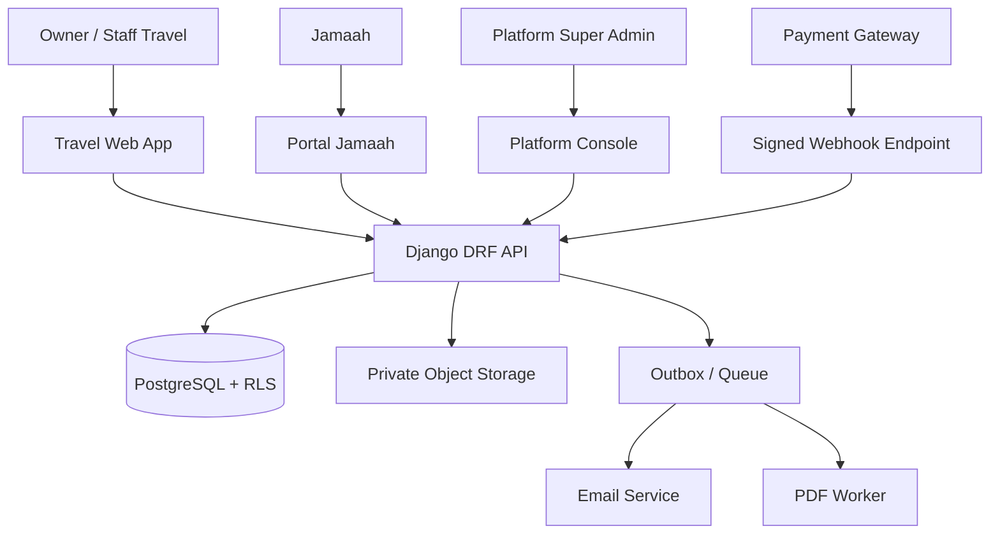

# PRODUCT SPECIFICATION — SISTEM MANAJEMEN TRAVEL UMROH & HAJI (SAAS)

**Versi:** 1.2 | **Tanggal:** 21 Oktober 2026 | **Status:** Technical baseline untuk implementasi dan review engineering  
**Dokumen sumber:** `PRD_Umrovia_SaaS_v3_5_Development_Roadmap.md` (§1–§54).  
**Audience:** Product Owner, Software Architect, Backend, Frontend, QA, DevOps, Security, Finance.  
**Sifat dokumen:** spesifikasi produk yang akan dibangun, bukan klaim fitur yang sudah berjalan pada situs demo Amsol.  
**Konvensi:** P0=MVP wajib, P1=lanjutan. `MUST`=wajib, `SHOULD`=direkomendasikan, `TBD`=perlu keputusan pemilik produk.

## 0. Keputusan definitif & urutan presedensi

Jika ketentuan pada bagian lama PRD (khususnya SaaS subscription bulanan v2) bertentangan, **§52 v3.3 > §51 v3.2 > §50 v3.1 > §42–49 v3.0 > §1–41**. Produk MVP **tidak memakai subscription bulanan**.

| ID | Ketentuan final | Implementasi |
|---|---|---|
| POL-01 | Registrasi gratis; setup standar Rp0; bulanan Rp0 | Tidak ada subscription billing rutin |
| POL-02 | Tarif SaaS Rp50.000 per *booking-jamaah nyata* | Versi tarif disimpan per charge; administrasi tarif di platform |
| POL-03 | Charge hanya setelah DP benar-benar diterima dan **diverifikasi** | Payment verification + atomic wallet charge |
| POL-04 | Tepat satu charge untuk satu booking-jamaah | Constraint unik dan idempotency key |
| POL-05 | Wallet prepaid tenant untuk biaya SaaS | Ledger terpisah dari kas/bank jamaah milik travel |
| POL-06 | Saldo tidak cukup: DP tetap tercatat; booking `pending_charge` | Proses konfirmasi ditunda, pelayanan jamaah aktif tidak dibekukan |
| POL-07 | Free trial 30×24 jam sejak provisioning sukses | Trial timer server-side UTC, ditampilkan timezone tenant |
| POL-08 | Selama trial maksimal 20 **booking-jamaah dummy kumulatif** dan 3 internal user | Quota atomik; delete tidak mengembalikan kuota |
| POL-09 | Trial Rp0, hanya simulasi, watermark DEMO dan tanpa gateway live | Demo namespace terpisah dari produksi |
| POL-10 | Trial habis/convert dini => Active otomatis tanpa biaya | Data demo tidak diubah menjadi transaksi nyata |
| POL-11 | Invoice+kuitansi, portal jamaah, pembayaran/manifest/keberangkatan, email/in-app, laporan | Semua masuk P0 |
| POL-12 | WhatsApp resmi, workflow visa/tiket lanjutan, GL accounting | P1/opsional dengan biaya transparan |

**Unit charging:** satu `booking_participant_id` merupakan satu hak ikut perjalanan untuk satu jamaah pada satu booking/departure, bukan satu profil jamaah, satu invoice, satu cicilan, atau satu pembayaran. Satu jamaah yang ikut dua perjalanan dapat memiliki dua unit charge; satu DP yang menutup beberapa peserta dapat memicu beberapa unit charge setelah alokasi DP per peserta terverifikasi.


## 1. Tujuan, batasan dan glossary

### 1.1 Tujuan MVP
- Tenant travel dapat mandiri mendaftar, mencoba data dummy, beralih produksi, mengelola calon jamaah hingga keberangkatan, menagih, menerima/verifikasi DP, dan melihat laporan.
- Platform owner dapat mengelola tenant, harga, saldo SaaS, fraud/support, serta memantau penggunaan dan rekonsiliasi.
- Jamaah dapat mengakses portal miliknya, unggah dokumen dan memeriksa progres, invoice, kuitansi, dan jadwal.

### 1.2 In-scope P0
Global authentication, tenant workspace, trial, master data, paket, keberangkatan, data jamaah, booking, invoice/kuitansi, DP, dokumen, manifest, notifikasi dasar, laporan siap pakai, SaaS wallet/top-up/charge, platform console, audit, backup dan export.

### 1.3 Out-of-scope P0
Langganan bulanan, postpaid Enterprise, custom domain, SSO korporat, WhatsApp/SMS berbayar, tiket/hotel/visa terpadu, akuntansi GL/neraca formal, mobile app native, integrasi pemerintah otomatis tanpa izin/API resmi.

### 1.4 Glossary
`tenant`: badan usaha travel; `owner`: admin utama tenant; `participant`: jamaah pada booking tertentu; `DP`: uang muka perjalanan milik travel; `verified payment`: pembayaran telah diperiksa petugas berwenang atau status gateway valid; `SaaS wallet`: prabayar tenant ke platform; `demo environment`: rekaman simulasi yang tidak memiliki efek produksi; `charge`: biaya Rp50.000 per participant eligible; `outbox`: event transaksi disimpan secara andal untuk diproses asinkron.


## 2. Arsitektur sistem

### 2.1 Pilihan teknologi yang direkomendasikan (bukan ketentuan historis PRD)
| Layer | Rekomendasi | Alasan |
|---|---|---|
| Backend | Python 3.13 + Django 5.2 LTS + Django REST Framework (versi dievaluasi ulang saat implementasi) | Modul bisnis/otorisasi/admin cepat dikembangkan |
| Frontend | Next.js + TypeScript, komponen UI responsif | Portal operator, jamaah dan platform terpisah secara logical |
| Database | PostgreSQL 17+ | Transaksi ACID, constraint, RLS, advisory lock |
| Queue | Celery + Redis | Email, PDF, reminder, reconcile, ekspor |
| Object storage | S3-compatible private bucket | Berkas jamaah dan generated PDFs |
| Payments | Adapter payment gateway Indonesia (pilihan provider TBD) | Tokenized top-up dan webhook terverifikasi |
| PDF | Server-side HTML-to-PDF + versi template | Document immutability dan branding |
| Monitoring | OpenTelemetry + metrics/log tracing + error tracker | Audit dan debugging multi-tenant |
| Deployment | Docker, reverse proxy, CI/CD, managed PostgreSQL atau VPS ter-hardening | Operasi awal sederhana, dapat berkembang |

**Modular monolith** dengan domain apps: `identity`, `tenancy`, `trial`, `catalog`, `crm`, `pilgrims`, `booking`, `payments`, `travel_finance`, `wallet`, `documents`, `departures`, `notifications`, `reporting`, `platform`, `support`, `audit`. Pisahkan skema API platform `/api/v1/platform/*`, travel `/api/v1/*`, jamaah `/api/v1/portal/*`.

### 2.2 Boundary dan isolasi
- Shared DB dan semua tabel bisnis berkolom `tenant_id`; PostgreSQL RLS default deny diaktifkan untuk data tenant, ditambah queryset scope aplikasi (*defense-in-depth*).
- Aplikasi menetapkan `SET LOCAL app.tenant_id` setiap transaksi setelah membership dikonfirmasi; gunakan koneksi request-bound dan reset connection pool secara aman. Jangan memakai `SET` global yang bocor ke request berikutnya.
- Identifier tenant berasal dari domain/slug tervalidasi atau workspace di token; client-supplied `tenant_id` tidak boleh dipercaya. Authorization berlaku pada setiap endpoint dan objek.
- Resource demo dan production wajib memakai `environment` terikat tenant, dijaga lewat RLS/policy dan FK komposit atau namespace storage. Pada tenant trial, API produksi write ditolak. Pada Active, akses demo hanya melalui view terpisah yang read-only sesuai kebijakan retensi.
- Service account queue menerima tenant+environment context yang ditandatangani/diambil DB; jangan mengekspos RLS bypass untuk akun aplikasi biasa. Elevated support access harus approval, logged, time-limited.

### 2.3 Diagram konteks


### 2.4 Transaksi penting
Critical path berupa DB transaction (verifikasi DP, invoice/kuitansi, wallet deduction) dan outbox; external calls **tidak** dilakukan di dalam transaction. Webhook disimpan dan divalidasi sebelum diproses asinkron. Exports dan email memakai queued worker.


## 3. Peran, akses dan batas otorisasi

| Role | Cakupan | Kemampuan utama | Larangan |
|---|---|---|---|
| Platform Super Admin | Platform | Tenant, trial, tarif, override, fraud/suspend, audit | Membaca PII jamaah tanpa prosedur support khusus |
| Platform Billing | Platform | Top-up, charge, reconciliation, credit/refund | Mengakses paspor/dokumen tenant |
| Platform Support | Platform | Tiket dan metadata diagnosis | Membaca data tenant tanpa consent dan time-bound elevation |
| Tenant Owner | Tenant | Semua setelan tenant, keanggotaan, konversi trial, wallet, laporan | Melihat tenant lain |
| Tenant Admin | Tenant | Master, staf tertentu, booking, operasional | Aksi wallet sensitif jika tidak didelegasikan |
| Sales/CS | Tenant / cabang | Leads, booking, invoice view | Verifikasi pembayaran/ubah tarif SaaS |
| Finance | Tenant / cabang | DP, kuitansi, kas/bank, wallet top-up, finance report | Ubah pasien/jamaah dari tenant lain |
| Operations | Tenant / cabang | Jadwal, dokumen, manifest dan kesiapan | Menyatakan DP verified tanpa izin |
| Document Reviewer | Tenant / cabang | Review berkas jamaah | Akses rekening dan payment verification |
| Agen (P1 portal) | Tenant | Booking yang direferensikan, komisi sendiri | Data agen lain |
| Jamaah | Booking milik sendiri | Status, upload, dokumen dan bukti bayar | Jamaah lain, biaya SaaS tenant |

**Permission pattern:** `domain.object.action` misalnya `payments.verify`, `wallet.topup`, `departures.publish`, `documents.review`, `reports.export_pii`, `trial.convert`. Selain role, enforce tenant, branch, ownership, environment, status objek dan step-up auth untuk tindakan sensitif.

**Matriks ringkas** (`Y`=boleh, `S`=scope/approval, `—`=tidak):
| Aksi | Owner | Admin | Sales | Finance | Ops | Jamaah |
|---|---|---|---|---|---|---|
| Create booking | Y | Y | Y | S | S | — |
| Verify DP | Y | S | — | Y | — | — |
| Top-up wallet | Y | S | — | S | — | — |
| Approve document | Y | Y | — | — | Y | — |
| Export manifest dengan PII | Y | S | — | — | S | — |
| Konversi trial dini | Y | — | — | — | — | — |
| Upload dokumen pribadi | S | S | — | — | S | Y |
| Kelola tarif platform | — | — | — | — | — | — |

Platform Super Admin saja yang dapat mengelola tarif; tidak dapat otomatis menggunakan hak Owner tenant.


## 4. Spesifikasi UI/UX, navigasi dan design behavior

### 4.1 Struktur navigasi
```
PUBLIC: Landing | Pricing (Rp50.000/jamaah) | FAQ | Sign-up | Login | Reset Password
TRAVEL: Dashboard | Leads | Jamaah | Paket | Keberangkatan | Booking
        Keuangan (Invoice, Pembayaran, Kas/Bank, Pengeluaran) | Dokumen
        Manifest | Laporan | Notifikasi | SaaS Wallet | Pengguna & Role | Profil Travel
        Trial Banner (jika trial) | Demo Workspace (jika trial)
JAMAAH: Ringkasan Perjalanan | Pembayaran | Invoice/Kuitansi | Dokumen | Jadwal | Notifikasi | Profil
PLATFORM: Overview | Tenants | Trial Management | Pricing | Wallet & Top-ups
          Charges & Reconciliation | Support | Security/Audit | Settings
```

### 4.2 Layout umum
Desktop: sidebar 240–280px, header workspace/tenant dan environment badge, date filters serta breadcrumb. Tablet/mobile: responsive drawer, tabel horizontal/stacked, tombol aksi utama mudah diakses. Semua form punya validation inline, empty/loading/error/success state dan unsaved-changes prompt.

### 4.3 Komponen kritis
- Header selalu memperlihatkan **nama tenant** dan status `DEMO/PRODUCTION`; beda warna saja tidak cukup, pakai teks.
- Trial banner: countdown absolut, used/limit booking dummy dan user, aksi `Mulai Gunakan Data Nyata`/`Convert Now` hanya Owner.
- Charge preview pada verifikasi DP: participant eligible, tarif efektif, saldo sekarang, saldo setelah charge, indikator charge previously applied.
- Saldo kurang: modal informatif dan CTA top-up, sementara rekaman DP tetap berhasil. Pesan UI tidak menyatakan DP gagal.
- Kuitansi & invoice: dokumentasi issuer travel; footer digital stamp/info legal tenant; dokumen demo menggunakan watermark jelas.
- Dokumentasi jamaah: checklist status + alasan penolakan + tanggal versi.
- Export sensitif: konfirmasi purpose dan audit; PII masked bila role tidak punya izin.

### 4.4 UX accessibility
Keyboard navigation, label screen reader, color contrast WCAG 2.2 AA ditargetkan, locale `id-ID`, currency integer rupiah, date/time `Asia/Jakarta` default. Hindari upload gambar yang tak terkompresi; progress indicator untuk upload.


## 5. Model database: konvensi & entitas

**Konvensi:** PK UUIDv7/UUID (Django UUIDField), UTC `timestamptz`, rupiah `bigint` nonnegatif untuk nominal transfer/kuitansi, decimal(18,2) bila currency lain di masa depan; foreign key memiliki index, field `created_at/updated_at`, `created_by`, `tenant_id` untuk semua business tables. Jangan menyimpan CVV/nomor kartu. Sensitive fields terenkripsi pada application/storage layer.

### 5.1 Identity, tenancy & trial
| Table | Kolom esensial | Constraint / index |
|---|---|---|
| users | id, email, password_hash, email_verified_at, mfa_enabled, status | UNIQUE lower(email) |
| tenants | id, slug, legal_name, display_name, phone, timezone, state, active_at | UNIQUE slug |
| tenant_memberships | id, tenant_id, user_id, role_id, branch_id nullable, status | UNIQUE (tenant_id,user_id,branch_id) sesuai kebijakan membership |
| roles | id, tenant_id nullable (null=system), name, permissions_json | Unik tenant+name |
| tenant_settings | tenant_id PK, branding_json, invoice_config_json, rules_json | 1:1 tenant |
| tenant_trials | id, tenant_id, started_at, ends_at, converted_at, status, dummy_count, config_snapshot_json | UNIQUE tenant_id |
| tenant_trial_events | id, tenant_id, actor_id, type, reason, metadata_json, occurred_at | append-only; tenant/time index |
| trial_entitlements | tenant_id PK, internal_users_limit, dummy_booking_limit, trial_features_json | snapshot immutable kecuali admin override |
| tenant_environment | id, tenant_id, environment, state | UNIQUE(tenant_id,environment) |
| branches | id, tenant_id, code, name, location | UNIQUE(tenant_id, code, environment) jika environment scoped |

### 5.2 Travel, peserta, dokumen dan booking
| Table | Kolom esensial | Constraint |
|---|---|---|
| pilgrims | id, tenant_id, environment, name, birth_date, contact, identity_encrypted, passport_masked, status | search normalisasi aman; jangan global-unique identity |
| agents | id, tenant_id, environment, code, name, phone, commission_rule | UNIQUE(tenant_id,environment,code) |
| packages | id, tenant_id, environment, code, name, description, price_idr, inclusions_json, published | UNIQUE composite code |
| departures | id, tenant_id, environment, package_id, start_at, end_at, seat_capacity, status, lead_staff_id | CHECK capacity >= 0 |
| bookings | id, tenant_id, environment, code, departure_id, agent_id nullable, branch_id, status, booked_at | UNIQUE composite code |
| booking_participants | id, tenant_id, environment, booking_id, pilgrim_id, participant_status, saas_charge_state, dp_eligible_at | UNIQUE(booking_id,pilgrim_id) unless explicit repeat allowed by business contract |
| booking_price_lines | id, tenant_id, booking_id, item_type, description, qty, unit_price, amount | sum invoice lines deterministic |
| document_requirements | id, tenant_id, environment, package_id nullable, kind, mandatory, deadline_rule | scoped requirements |
| pilgrim_documents | id, tenant_id, environment, booking_participant_id, kind, object_key, version, status, reviewed_by, reason | UNIQUE(participant,kind,version) |
| manifest_versions | id, tenant_id, environment, departure_id, version_no, published_by, snapshot_object_key, checksum | UNIQUE(departure,version_no) |
| departure_events | id, tenant_id, environment, departure_id, prior_status, next_status, actor_id, reason | append-only |

**Integrity note:** Buat FK komposit `(tenant_id, environment, id)` atau trigger pemeriksaan agar referensi dari tenant/environment berbeda ditolak juga di level database. `object_key` memakai prefix tenant/environment dan signed URL hanya dihasilkan setelah cek permission.

### 5.3 Keuangan travel (bukan dana SaaS)
| Table | Kolom | Constraint |
|---|---|---|
| travel_invoices | id, tenant_id, environment, booking_id, invoice_number, status, issue_at, due_at, total_idr, balance_idr, pdf_key, version | UNIQUE composite invoice_number; no hard delete issued |
| invoice_lines | id, tenant_id, invoice_id, participant_id nullable, description, amount_idr | sum equals invoice total |
| travel_payments | id, tenant_id, environment, booking_id, provider_ref nullable, received_at, amount_idr, status, verified_by, verified_at, kind | UNIQUE gateway event/provider ref when present |
| payment_allocations | id, tenant_id, payment_id, invoice_id, participant_id, amount_idr | sum allocations <= payment amount |
| travel_receipts | id, tenant_id, payment_id, receipt_no, pdf_key, issued_at, status | UNIQUE(tenant_id,payment_id) for final receipt |
| travel_bank_accounts | id, tenant_id, bank_name, account_masked, account_name, active | tenant-only |
| travel_cash_transactions | id, tenant_id, account_id, direction, amount_idr, payment_id nullable, expense_id nullable | append-only with corrections |
| travel_expenses | id, tenant_id, departure_id, category, vendor_id nullable, amount_idr, status | approval audit |
| credit_notes | id, tenant_id, invoice_id, amount_idr, reason, actor_id | append-only adjustment |

### 5.4 SaaS wallet, billing dan settlement
| Table | Kolom esensial | Critical invariant |
|---|---|---|
| wallets | id, tenant_id, currency, status, balance_cached_idr, version | UNIQUE(tenant_id,currency) |
| wallet_ledger | id, wallet_id, tenant_id, kind, signed_amount_idr, reference_type, reference_id, balance_after_idr, created_at | append-only; `reference_type/reference_id` dedup per kind |
| wallet_topups | id, tenant_id, wallet_id, amount_idr, provider, provider_txn_id, status, paid_at, expiration_at | UNIQUE(provider,provider_txn_id) partial; idempotency |
| pricing_versions | id, unit_type, price_idr, effective_from, effective_to, active, version | nonoverlap effective pricing |
| tenant_price_overrides | id, tenant_id, pricing_version_id, unit_price_idr, valid_from, valid_to, reason | audited |
| saas_charges | id, tenant_id, booking_participant_id, wallet_id, unit_price_idr, price_version_id, status, charged_at, ledger_entry_id | UNIQUE(tenant_id,booking_participant_id,charge_type='initial') |
| saas_adjustments | id, tenant_id, charge_id, amount_idr, reason, approver_id, ledger_entry_id | credit/debit append-only |
| payment_webhook_events | id, provider, event_id, signature_valid, payload_hash, received_at, process_status | UNIQUE(provider,event_id) |
| billing_documents | id, tenant_id, doc_type, ref_id, number, pdf_key, created_at | SaaS invoice/statement separate numbering |
| reconciliation_runs | id, provider, period_start, period_end, status, variance_idr, finished_at | trace unmatched events |

**Wallet sign convention:** top-up/credit `+`, charge/refund outflow `-`; all ledger rows immutable; reconciled wallet balance = SUM(ledger.signed_amount). Negative wallet balance prohibited in prepaid. `balance_cached_idr` is cache updated within same transaction, routinely reconciled.

### 5.5 Events, notifications, audit, export
`outbox_events(id, tenant_id, environment, event_type, aggregate_id, payload_safe_json, occurred_at, published_at, retry_count)`; `notification_templates`, `notification_deliveries` with unique `(source_event_id,recipient,channel,template_key)`; `support_tickets`; `audit_events` with actor/action/object/tenant/IP/redacted change summary; `export_jobs` with tenant, filter snapshot, purpose, owner, file_key, expires_at; `idempotency_keys` with scope, request_hash, response_summary, expires_at.

### 5.6 SQL invariants (pseudo-DDL)
```sql
CREATE UNIQUE INDEX uq_saas_charge_once
  ON saas_charges(tenant_id, booking_participant_id)
  WHERE charge_type = 'initial' AND status <> 'void_precommit';
CREATE UNIQUE INDEX uq_final_receipt_payment
  ON travel_receipts(tenant_id, payment_id) WHERE status = 'issued';
CREATE UNIQUE INDEX uq_webhook_event
  ON payment_webhook_events(provider, event_id);
-- RLS sample; apply/verify on EVERY tenant-scoped table:
ALTER TABLE bookings ENABLE ROW LEVEL SECURITY;
ALTER TABLE bookings FORCE ROW LEVEL SECURITY;
CREATE POLICY tenant_scope_bookings ON bookings
  USING (tenant_id = current_setting('app.tenant_id', true)::uuid)
  WITH CHECK (tenant_id = current_setting('app.tenant_id', true)::uuid);
```
RLS sample requires a fail-closed policy if missing tenant context; environment restriction is additionally enforced (policy, FK and application guard). Transactional test must prove production records cannot be read through demo context.


## 6. State machines & domain contracts

### 6.1 Tenant/trial
`PENDING_EMAIL → PROVISIONING → TRIAL → ACTIVE → (RESTRICTED | SUSPENDED) → TERMINATED`. Provisioning retry preserves exactly one tenant. `TRIAL → ACTIVE` occurs on explicit convert or expiration, never creates paid charge. `RESTRICTED` denotes *charge pending because prepaid balance insufficient*, not full user block. Security suspension managed independently.

`trial_status=running | converted_early | expired_converted | extended`, event log append-only. Start after provisioning committed; cron expiration job compares `now_utc >= ends_at`, `SELECT FOR UPDATE` to avoid race with early conversion.

### 6.2 Booking participant
`DRAFT → REGISTERED → AWAITING_DP → DP_VERIFIED_PENDING_CHARGE → CONFIRMED → READY → DEPARTED → COMPLETED` with exception `CANCELED` and `REVIEW_REQUIRED`. DP can be verified when real funds are received, independent of SaaS wallet. Once charged, repeated payment/cicilan cannot charge again. `pending_charge` only blocks final *new* confirmation, not DP recording or activities necessary for existing traveling users.

### 6.3 Travel payment
`DRAFT → SUBMITTED → VERIFIED` or `REJECTED`, then reversal via explicit `REVERSED` event with approval. For gateway callback, provider verified signature and settlement semantics must be satisfied before `VERIFIED`; manual bank transfer requires finance staff verification and attachment/trace. Never silently mutate verified amount: reverse+new event.

### 6.4 Invoice/receipt
Invoice: `DRAFT → ISSUED → PARTIALLY_PAID → PAID`, cancellation via `VOIDED` / `CREDITED` with reason. Receipt: `ISSUED → REVERSED` only through audit/correction. Issued PDF content snapshot stable and checksummed.

### 6.5 Departure
`DRAFT → OPEN → READY → DEPARTED → COMPLETED` or `CANCELED`. `READY` requires checklist completeness or approved exception; verify capacity within locked transaction on booking assignment.

### 6.6 Wallet
Top-up: `CREATED → PENDING → PAID` or `EXPIRED/FAILED` (no double-credit). Charge: `PENDING → POSTED` when wallet sufficient; pending remains retriable; refund by *separate compensating credit*, never deleting ledger.


## 7. Core business workflows: sequence dan edge cases

### 7.1 Signup → trial
1. Submit email, password, travel name, slug, T&C/privacy consent -> captcha/rate limit.
2. Kirim email verify link TTL dan one-time nonce; sampai verified belum ada active workspace.
3. Provision tenant, owner membership, demo environment, trial record (`started_at=provisioned_at`, `ends_at=+30 days`), limits 20/3.
4. Login -> demo banner, quick-start checklist: 1 paket, 1 jadwal, 1 booking dummy, simulasi DP, invoice, manifest, laporan.
5. Atomic increment booking dummy counter **sebelum create**, rolled back bila create gagal; tidak dikurangi jika record dihapus.
6. Reminder at 7/3/1 days, dedupe `(trial_id,event_type,recipient)`.

### 7.2 Trial conversion
1. Owner POST convert dengan confirmation; backend locks trial/tenant.
2. Mark converted, close demo writes, provision production namespace, switch context.
3. Data demo remain segregated and read-only for retention window; production master starts clean (optional intentional copy of harmless settings/logo only).
4. Explain wallet top-up and charge condition; zero fee on conversion. Background expiry uses same service method.
5. Do not accept real DP/gateway in trial. Conversion can happen immediately before real operations.

### 7.3 Produksi: Booking → invoice → DP → wallet charge
1. Staff select package/departure and adds unique participant(s); validate seat capacity with row lock.
2. Issue invoice once per booking (or configured participant-level invoice) with itemized lines; PDF generated from immutable snapshot via outbox.
3. Tenant receives DP via their bank/payment rail. Record payment and allocate to eligible participant(s), not just booking header.
4. Finance verifies DP (approval rule); store verified timestamp, actor, source and each participant allocation within DB transaction.
5. For each participant whose required DP is verified, attempt charge. Lock wallet and booking participant. Check `saas_charges` unique record; price snapshot defaults Rp50.000.
6. Sufficient wallet: append ledger `-50000`, create `saas_charges POSTED`, update participant CONFIRMED, publish charge/payment verified/receipt notification outbox.
7. Insufficient wallet: DP remains VERIFIED, participant `DP_VERIFIED_PENDING_CHARGE`, charge remains pending; send low balance alert to owner. Receipt still issued for verified payment.
8. On settled wallet top-up, enqueue retry pending charges FIFO by eligible_at (or explicit policy), with locks and idempotency.
9. Payment retries and webhook duplicates do not duplicate receipts/charges; any reversals are separate audited events.

**Multi-participant DP allocation:** finance explicitly allocates verified DP across participant IDs; charging starts only for participants satisfying their own DP eligibility threshold (configured minimum or any positive verified DP—business policy TBD). No automatic charge for all participants merely because one group payment exists.

### 7.4 Top-up gateway
1. Owner/Finance requests amount `>0`, server creates idempotent pending topup and gateway payment intent.
2. Gateway callback: verify transport/authenticity, signature/HMAC or server-to-server reconciliation, amount, currency, order reference, status and anti-replay.
3. Lock top-up; transition to paid once, append `+amount` wallet ledger, update balance and issue top-up proof. Ignore duplicate paid callback; never trust only browser success redirect.
4. Enqueue pending charge settlement. Refund gateway/chargeback requires explicit compensating ledger and freeze policy for negative exposure, with review.

### 7.5 Cancellation / refund
- Booking canceled before verified DP: no SaaS charge; void draft invoice if permitted.
- After posted SaaS charge: no automatic refund; platform billing may approve adjustment to wallet under audited policy (TBD). Travel refund to jamaah is **separate** from SaaS adjustment.
- Corrections to verified payments retain historical records and produce reversal entries; if fraudulent DP was approved mistakenly, mark case to review and require two-person approval for SaaS credit.

### 7.6 Documents, manifest, notification
Jamaah invited with one-time scoped link, uploads private object, status `PENDING_REVIEW`, reviewer approves/rejects with reason, portal timeline updates. Manifest built from booking participants departure; publish snapshot version; export PII requires permissions/audit. Events generate in-app and email with retry (never send passports as mail attachments).


## 8. API specification v1

**Base path:** `/api/v1`; HTTPS JSON, OAuth/OIDC compatible session or JWT short-lived access with rotating refresh; CSRF enforced for cookie authentication. Request header `Idempotency-Key` on all financial POST. RFC7807 error style (`type,title,status,code,detail,request_id,field_errors`). Pagination cursor or page+size documented; ISO-8601 timestamps UTC; rupiah integer.

### 8.1 Authentication & tenant
| Method | Endpoint | Role | Purpose |
|---|---|---|---|
| POST | `/auth/register` | Public | Sign-up travel; rate limit |
| POST | `/auth/verify-email` | Public token | Activate verified identity |
| POST | `/auth/login` | Public | Start session |
| POST | `/auth/logout` | Logged-in | Revoke token |
| POST | `/auth/refresh` | Session | Token rotation |
| GET | `/me` | Logged-in | Membership/workspaces |
| POST | `/workspaces/switch` | Member | Switch tenant explicitly |
| GET/PATCH | `/tenant/settings` | Owner/Admin | Branding & business config |
| GET/POST | `/memberships` | Owner/Admin | Staff list/invite |
| PATCH/DELETE | `/memberships/{id}` | Owner | Role/revoke |

### 8.2 Trial
| Method | Endpoint | Role | Purpose |
|---|---|---|---|
| GET | `/trial/status` | Owner/Admin | Timer, quotas, conversion status |
| POST | `/trial/convert` | Owner | Early conversion, idempotent |
| POST | `/trial/demo-bookings` | Admin/Sales trial | Create dummy; count limited |
| GET | `/trial/demo-data` | Owner | Read-only segregated after conversion |
| GET | `/platform/trials` | Super Admin | Filter tenant/trial statistics |
| POST | `/platform/trials/{id}/extend` | Super Admin | Reasoned audited extension |

### 8.3 Travel operations
| Method | Endpoint | Role | Purpose |
|---|---|---|---|
| GET/POST | `/pilgrims` | Tenant staff | List/create master jamaah |
| GET/PATCH | `/pilgrims/{id}` | Scoped staff | View/update permitted fields |
| GET/POST | `/packages` | Owner/Admin/Ops | Package catalog |
| GET/POST | `/departures` | Ops/Admin | Departure roster |
| POST | `/departures/{id}/transition` | Ops/Admin | READY/DEPARTED/etc with guard |
| GET/POST | `/bookings` | Sales/Admin | Bookings with participants |
| GET/PATCH | `/bookings/{id}` | Scoped staff | Detail/update draft |
| POST | `/bookings/{id}/issue-invoice` | Finance/Admin | Issue invoice idempotently |
| GET | `/invoices/{id}/pdf` | Allowed staff/jamaah scoped | Short-lived PDF access |
| POST | `/payments` | Finance/Sales limited | Record DP/balance evidence |
| POST | `/payments/{id}/verify` | Finance/Owner | Verify funds and allocations; wallet attempt |
| POST | `/payments/{id}/reverse` | Finance+approval | Explicit reversal |
| GET | `/receipts/{id}/pdf` | Authorized | Final receipt |
| GET | `/departures/{id}/manifest` | Ops/Admin | Manifest list/filters |
| POST | `/departures/{id}/manifest/publish` | Ops/Admin | Version snapshot |
| POST | `/exports` | Permission-based | Queued PDF/XLSX/CSV |
| GET | `/exports/{job_id}` | Requester | Status / signed download |

### 8.4 Portal jamaah
| Method | Endpoint | Role | Purpose |
|---|---|---|---|
| POST | `/portal/accept-invite` | Invite token | Bind user to participant |
| GET | `/portal/me/bookings` | Jamaah | Authorized own bookings |
| GET | `/portal/bookings/{id}` | Jamaah scoped | Payment/doc/departure progress |
| POST | `/portal/documents/presign` | Jamaah scoped | Upload intent, object policy |
| POST | `/portal/documents/complete` | Jamaah scoped | Commit object metadata after scan |
| GET | `/portal/documents` | Jamaah scoped | Required items and statuses |
| GET | `/portal/invoices` | Jamaah scoped | Own invoices |
| GET | `/portal/notifications` | Jamaah scoped | Inbox |

### 8.5 SaaS wallet and platform
| Method | Endpoint | Role | Purpose |
|---|---|---|---|
| GET | `/wallet` | Owner/Finance | Balance, usage, pending charges |
| GET | `/wallet/ledger` | Owner/Finance | Filtered transaction list |
| POST | `/wallet/topups` | Owner/Finance | Create payment intent |
| GET | `/wallet/topups/{id}` | Owner/Finance | Status |
| GET | `/wallet/charges` | Owner/Finance | Charges with participant reference |
| GET | `/reports/operational` | Scoped staff | Occupancy, bookings, readiness |
| GET | `/reports/finance` | Owner/Finance | Receipts, outstanding, expenses |
| GET | `/reports/saas-usage` | Owner/Finance | Wallet/charge/usage |
| POST | `/webhooks/payments/{provider}` | Provider only | Verified gateway callback |
| GET | `/platform/tenants` | Platform Admin | List / lifecycle |
| POST | `/platform/tenants/{id}/suspend` | Super Admin | Audited security suspension |
| GET/POST | `/platform/pricing` | Platform Admin | Price versioning |
| POST | `/platform/saas-adjustments` | Platform Billing authorized | Two-person credit/debit approval |
| GET | `/platform/reconciliation` | Platform Billing | Unmatched balance and events |

### 8.6 Example: manual DP verification
Request:
```http
POST /api/v1/payments/pm_uuid/verify
Authorization: Bearer <access_token>
Idempotency-Key: dpverify-tenant-uuid-payment-uuid
Content-Type: application/json
```
```json
{
  "verified_received_at": "2026-10-21T03:15:00Z",
  "evidence_ref": "upload-uuid",
  "allocations": [{"booking_participant_id":"participant-uuid", "amount_idr":1000000}],
  "verification_note":"Transfer bank sudah cocok"
}
```
Successful response `200`:
```json
{
  "payment_id":"pm_uuid", "payment_status":"VERIFIED",
  "receipt_status":"ISSUED",
  "participants":[{"id":"participant-uuid","saas_charge_status":"POSTED","unit_fee_idr":50000}],
  "wallet_balance_idr":150000
}
```
If wallet insufficient, **verification still succeeds** (`200`) and response includes `saas_charge_status:"PENDING_INSUFFICIENT_FUNDS"`; do not return generic 402 to imply DP failure.

### 8.7 Example: trial status
```json
{
  "trial_status":"RUNNING", "started_at":"2026-10-21T03:00:00Z",
  "ends_at":"2026-11-20T03:00:00Z", "dummy_bookings_used":12,
  "dummy_bookings_limit":20, "internal_users_used":2,
  "internal_users_limit":3, "trial_price_idr":0,
  "can_convert_now":true
}
```

### 8.8 Example: wallet top-up
Request: `POST /api/v1/wallet/topups` with `{ "amount_idr": 1000000, "payment_method":"virtual_account" }`. Response `201` includes `topup_id`, `status=PENDING`, gateway checkout/payment instructions and expiry; **balance not increased** until verified provider callback.

### 8.9 Error codes
`TENANT_CONTEXT_REQUIRED`, `TENANT_ACCESS_DENIED`, `ENVIRONMENT_MISMATCH`, `TRIAL_QUOTA_EXCEEDED`, `TRIAL_USER_LIMIT`, `TRIAL_ALREADY_USED`, `PAYMENT_NOT_VERIFIABLE`, `PAYMENT_ALREADY_VERIFIED`, `ALLOCATION_INVALID`, `INSUFFICIENT_WALLET_BALANCE`, `BOOKING_ALREADY_CHARGED`, `DEPARTURE_CAPACITY_FULL`, `DOCUMENT_NOT_AUTHORIZED`, `EXPORT_PERMISSION_DENIED`, `IDEMPOTENCY_KEY_CONFLICT`, `RATE_LIMITED`.


## 9. Service layer & pseudocode transaksi inti

### 9.1 Verifikasi DP (transaction boundary)
```python
@transaction.atomic
def verify_dp(payment_id, allocations, actor, request_key):
    idem = lock_or_create_idempotency(actor.tenant_id, request_key)
    if idem.completed:
        return idem.saved_response
    payment = TravelPayment.objects.select_for_update().get(id=payment_id)
    assert_can_verify(actor, payment)
    validate_evidence_and_allocations(payment, allocations)
    if payment.status != 'VERIFIED':
        payment.mark_verified(actor)
        save_allocations(payment, allocations)
        create_receipt_once(payment)  # unique payment_id
    for participant in eligible_participants(payment):
        attempt_saas_charge_locked(participant)  # handles pending funds
    enqueue_outbox_once('payment.verified', payment.id)
    return idem.commit_response(serialize_payment_result(payment))
```

### 9.2 Charge sekali per booking-jamaah
```python
@transaction.atomic
def attempt_saas_charge_locked(participant):
    p = BookingParticipant.objects.select_for_update().get(pk=participant.pk)
    if not verified_dp_eligible(p):
        return 'NOT_ELIGIBLE'
    if SaaSCharge.objects.filter(tenant_id=p.tenant_id,
                                 booking_participant_id=p.id,
                                 charge_type='initial', status='POSTED').exists():
        return 'ALREADY_CHARGED'
    wallet = Wallet.objects.select_for_update().get(tenant_id=p.tenant_id)
    fee, price_id = resolve_effective_price(p.tenant_id, at=p.dp_verified_at)
    charge = get_or_create_initial_charge_locked(p, fee, price_id)
    if wallet.balance_cached_idr < charge.unit_price_idr:
        charge.mark_pending('INSUFFICIENT_FUNDS')
        p.mark_pending_charge()
        return 'PENDING_INSUFFICIENT_FUNDS'
    ledger = ledger_append_unique(wallet, -charge.unit_price_idr, reference=charge.id)
    wallet.balance_cached_idr -= charge.unit_price_idr
    wallet.save(update_fields=['balance_cached_idr'])
    charge.mark_posted(ledger.id)
    p.mark_confirmed()
    enqueue_outbox_once('saas.charge.posted', charge.id)
    return 'POSTED'
```
Enforce database unique constraints; do not rely only on `.exists()` race check. Handle unique violation by reread and return existing outcome. Row lock order **wallet before participant** must be globally consistent in actual implementation; pseudocode above illustrates logic, adapt lock acquisition across all callers to avoid deadlocks. Use wallet lock then participant lock (or dedicated advisory lock) in all charge/top-up paths. For heavily parallel multi-participant charge use stable sort by IDs.

### 9.3 Retry pending charge
On top-up `PAID` event, enqueue `settle_pending_charges(tenant_id)`; worker obtains tenant wallet lock then FIFO participant/charge lock; no cross-tenant side effects; stops when funds exhausted; emits low balance warning deduped.

### 9.4 Processing external webhook
Signature/token and independent provider transaction lookup where supported; enforce amount/currency/id matching and monotonic status transition; persist raw payload in encrypted restricted storage with retention policy; `provider,event_id` unique; dispatch processing via outbox. Webhook must not trust claimed `tenant_id` in incoming payload, resolve through stored top-up reference.


## 10. Spesifikasi fungsional layar (P0)

| ID | Halaman | Input/filter utama | Aksi | Validasi, pesan dan output |
|---|---|---|---|---|
| UI-01 | Registrasi tenant | Nama travel, email owner, slug, sandi, persetujuan | Daftar/verifikasi | Validasi email/slug, anti-bot, verify link |
| UI-02 | Trial dashboard | Sisa waktu, booking used/20, user used/3 | Coba alur, convert | Status DEMO; no live funds |
| UI-03 | Travel dashboard | Period, package/departure | Drill-down | Booking, DP, status docs, wallet alert |
| UI-04 | Master paket | Nama, harga, fasilitas, keberangkatan | CRUD draft/publish | Versi pricing paket, audit |
| UI-05 | Keberangkatan | Kapasitas, tanggal, PIC | Open/ready/depart | Gate readiness and capacity |
| UI-06 | Jamaah | Profil, kontak, dokumen | CRUD/merge terkontrol | Field sensitif masked, duplicate hint |
| UI-07 | Booking | Jamaah, paket, departure, agent | Create/confirm draft | Seat availability + generated number |
| UI-08 | Invoice | Detail booking dan biaya | Issue/print/email | Unique immutable numbered PDF |
| UI-09 | Pembayaran | Transfer evidence, tanggal, alloc participant | Submit/verify/reverse | DP verified persisted even on low wallet |
| UI-10 | Receipt | Payment ref, amount, issuer | Download/resend | One verified payment, one receipt |
| UI-11 | Dokumen | Checklist, status, reviewer | Review/reject | Reason mandatory on reject, history |
| UI-12 | Manifest | Departure, status, filter | Snapshot/export | Role-based PII, version and timestamp |
| UI-13 | Portal jamaah | Booking, payment status, documents | Upload/track/download | Own data only; private file URL |
| UI-14 | Notifikasi | Inbox + preferences | Mark read/resend | Delivery state; tenant-specific templates |
| UI-15 | Operational report | Date, departure, package, branch | Export/drill-down | KPI as-of, PII safe |
| UI-16 | Finance report | Date, cashbank, invoice status | Export/drill-down | reconcile payment + outstanding |
| UI-17 | SaaS Wallet | Balance, credits, charges | Top up/view ledger | Differentiate tenant wallet vs travel cash |
| UI-18 | Trial management platform | Date, status, conversion | Extend / review | Reason+audit approval |
| UI-19 | Tenant management platform | Status, risk, wallet metadata | Suspend/re-activate | 2-person controls for critical cases |
| UI-20 | Billing reconciliation | provider date, matched state | investigate/adjust | no ledger edit; compensating adjustments |

### 10.1 Data field validation minimum
- Email RFC reasonable validation + verification; phone E.164 canonical with Indonesian presentation; `slug` lower-case 3–50 chars and reserved words blocked.
- Amount nonnegative integer rupiah and bounded; `verified_at` cannot precede `received_at` without authorized correction reason.
- Tanggal keberangkatan sebelum akhir perjalanan; capacity >= 0; booking participant unique in same departure unless explicit override policy.
- Passport/KTP sensitive: do not show full values by default; store encrypted, log redacted.
- Documents: allowlisted MIME (PDF/JPEG/PNG), configurable max MB (suggest 10MB), inspect magic bytes, scan malware, reject executable.

### 10.2 Template dokumen
Travel invoice: issuer legal name/address, invoice no and issue/due, buyer, booking, lines, tax/discount (if applicable), subtotal, grand total, paid/outstanding and support info. Receipt: receipt no, payment verified date, amount, purpose, linked invoice, accepted via, authorized issuer. Demo all outputs `DEMO-*` and watermark. Manifest: departure metadata, version/time, roster authorized fields and PII export audit.


## 11. Notifications, jobs and external integrations

### 11.1 Domain events and consumers
| Event | Trigger | Consumer | Idempotency |
|---|---|---|---|
| `tenant.trial.started` | Tenant ready | Welcome + dashboard | tenant+trial |
| `trial.reminder.d7/d3/d1` | Scheduler | Owner email/in-app | tenant+day+recipient+channel |
| `trial.converted` | Auto/manual | Welcome production | tenant+conversion |
| `booking.created` | Booking committed | Jamaah invitation/inbox | booking+recipient |
| `invoice.issued` | Invoice issued | Email and PDF | invoice id |
| `payment.verified` | DP verified | Receipt, portal, finance alert | payment id |
| `saas.charge.pending` | Wallet insufficient | Owner alert | participant+pending epoch |
| `wallet.topup.paid` | Gateway verified | Ledger credit, reconcile, retry charge | topup id |
| `document.rejected` | Reviewer | Jamaah notice with reason (without sensitive file) | doc version |
| `departure.changed` | Schedule revised | Affected pilgrims | departure revision |

### 11.2 Job catalog
`trial_expiry` hourly or more frequent operationally; `trial_reminders` daily at tenant-local schedule (UTC computed), `pending_charge_retry` after top-up and reconciliation, `notification_sender` queue with exponential backoff and DLQ, `document_scan`, `invoice_pdf`, `manifest_export`, `reconciliation_daily`, `wallet_balance_check`, `demo_retention_cleanup`, `backup_validation`, `anomaly_detection`.

### 11.3 Integration adapter standards
Providers isolated behind interfaces `PaymentGateway`, `EmailProvider`, `ObjectStorage`, `PDFRenderer`. Webhooks must have signature verification; message templates are versioned; sandbox and production credentials strictly separated. WhatsApp/SMS P1, no implied free messaging.


## 12. Laporan dan rumus

| Report | Kolom/metric inti | Sumber |
|---|---|---|
| Jamaah per paket/periode | bookings, participants, verified DP, confirmed, departed | participants + booking + payments |
| Seat occupancy | reserved, active, capacity, remaining | departures + participants |
| Kesiapan berangkat | dokumen wajib lengkap, payment gate, exception | docs + payments + departures |
| Piutang | invoice total - verified allocations - credit | travel invoices/allocations |
| Kas/Bank travel | opening + receipt inflow - approved outflow | travel_cash_transactions |
| Pengeluaran & margin estimasi | invoice sales - allocated expenses | invoice lines + expenses; label estimasi |
| SaaS usage per tenant | posted initial charges, pending, fee aggregate | saas_charges |
| Wallet statement | opening balance + credits - debits = closing | wallet_ledger |
| Platform revenue | posted charges - credit adjustments | platform ledger/finance policy |
| Trial funnel | signups, provisioned, trial active, conversions | tenant_trials + events |

Semua laporan memiliki filter `from/to`, tenant, cabang jika relevan, package/departure, status, snapshot `as_of`. Ekspor Excel/CSV/PDF dilakukan server side sesuai permission, signed download TTL, audit dan row limits. Revenue platform tidak boleh dihitung dari DP jamaah atau nominal wallet top-up; top-up adalah liabilitas/pra-bayar yang penggunaannya dicatat terpisah sesuai kebijakan akuntansi.


## 13. Security, privacy, compliance & non-functional requirements

| Domain | Requirement terukur / pengujian |
|---|---|
| Authorization | 100% endpoint object-level tenant+environment ACL, deny by default; negative tenant tests |
| Authentication | Password hashed Argon2id, email verify; MFA untuk Platform Admin dan role keuangan sensitif (P0 target) |
| PII | TLS, at-rest encryption, private buckets; signed URL ≤ 10 menit default; key rotation plan |
| Documents | Anti-malware, MIME sniffing, max size, no public ACL, access audit, sensitive log redaction |
| Abuse control | Login/signup/upload rate limit, CAPTCHA risk-based, trial one per company anti-abuse review |
| Integrity | ACID charge/top-up, ledger append-only, DB constraints, idempotency, concurrency tests |
| Performance | p95 normal API read <500ms baseline, dashboard render <3s target after instrumentation; export async |
| Availability | Pilot target 99.5% monthly, refine SLA before commercial commitment |
| Recovery | Proposed RPO ≤ 24h/RTO ≤ 8h at pilot, move toward RPO 1h/RTO 4h with budget review |
| Backup | Daily automated DB backup + PITR where supported, private encrypted storage, tested restore monthly |
| Retention | Trial demo 30 days after conversion proposed, production PII legally reviewed; no hardcoded uncontrolled purge |
| Audit | Actor, timestamp, origin, reason; append-only important financial/security actions |
| Observability | Request trace ID, tenant hashed ID, queue latency, failed gateway, duplicate prevention, balance discrepancy alerts |
| Compliance | Indonesia UU PDP obligations, consent notice, legal/finance review for invoicing/tax and data processing agreement before launch |

**Threat model key risks:** IDOR cross-tenant, environment bleed, forged webhook, replay, wallet double-spend, abusive trial, raw identity leak, signed URL oversharing, SMTP delivery to wrong recipient, malicious file upload, CSRF/session fixation, unauthorized adjustment. Each requires security test and mitigation ticket.


## 14. Test strategy and detailed UAT

### 14.1 Test levels
Unit tests for policies, totals and state transitions; integration tests with PostgreSQL/RLS, object storage and payment sandbox; API contract tests; E2E using Playwright; load and concurrency tests; SAST/dependency scans; backup/restore drill; chaos for callback/retry and worker shutdown.

### 14.2 MVP acceptance scenarios
| ID | Test | Expected |
|---|---|---|
| TR01 | Provision then trial start | 30×24h exact; setup time excluded |
| TR02 | Create 20 demo participants | 20 success, 21 rejected |
| TR03 | Delete demo record | Used count never decrements |
| TR04 | 3 internal users | fourth rejected; portal users excluded |
| TR05 | Demo PDF invoice & manifest | DEMO watermark, no real gateway or production report |
| TR06 | Demo DP simulation | SaaS ledger unchanged |
| TR07 | Retry reminders H-7/H-3/H-1 | One logical send per recipient/channel/event |
| TR08 | Trial expired | Auto Active, no bill, no suspension |
| TR09 | Early conversion | Single conversion, no trial reentry |
| TR10 | Cross tenant/environment access | 403/404 and zero leakage |
| PAY01 | Real DP verified with wallet Rp100k | Charge Rp50k one time; balance Rp50k |
| PAY02 | Repeat verification 10× concurrently | One SaaS charge, one final receipt |
| PAY03 | DP verified with zero wallet | DP VERIFIED; charge pending; receipt issued |
| PAY04 | Top-up settles after pending | One credit; pending charge posted once |
| PAY05 | Duplicate/out-of-order payment webhook | No duplicate credit, no state regression |
| PAY06 | Group DP for 3 participants, allocated to 1 | Only 1 eligible charge |
| PAY07 | Second installment/payment for same participant | No additional charge |
| PAY08 | Cancel before verified DP | No charge |
| PAY09 | Cancel after posted charge | No auto refund; approval required |
| PAY10 | Wallet concurrency 5 charges with funds for 2 | Exactly 2 posted, 3 pending; balance nonnegative |
| INV01 | Issue invoice twice | One active issued invoice version/number, history retained |
| INV02 | Verified payment and resend receipt | Same issued receipt, no duplicate |
| POR01 | Upload reject then reupload docs | Version history, user sees reason |
| POR02 | Access other pilgrim invoice via guessed UUID | 403/404; no signed URL |
| OPS01 | Departure capacity 20 + concurrent 2 for last seat | One accepted, one rejected |
| OPS02 | Ready without mandatory docs | Rejected absent approved exception |
| OPS03 | Manifest export with PII by unauthorized user | Rejected and audited |
| NTF01 | Email delivery fails | Queue retry; payment untouched |
| RPT01 | As-of finance report reconciliation | Report equals source transactional totals |
| RPT02 | SaaS wallet vs travel cash report | Completely distinct aggregates |
| SEC01 | Inject `tenant_id` of different travel | Server ignores/rejects, RLS blocks |
| SEC02 | Signed download expired | Denied |
| SEC03 | Replay refund/adjustment request | One compensating ledger entry only |

### 14.3 Contract tests
- Financial endpoints require idempotency key and request hash equality; same key + different payload => 409 conflict.
- All pagination includes deterministic ordering; `as_of` on financial reports.
- Timestamp comparison uses UTC; tenant-local reminder schedule computed correctly across dates.
- E2E full workflow: signup -> 20 dummy -> convert -> topup -> booking -> DP verified -> charge -> receipt -> upload document -> manifest -> depart -> report.


## 15. Implementation backlog and phase delivery

| Phase | Workstreams | Entry/exit criteria |
|---|---|---|
| P0-A Foundation | Auth, tenant provisioning, RLS, roles, audit, API skeleton | Cross-tenant denial tests pass |
| P0-B Trial | Sandbox env, quotas, timed conversion, reminder | TR01–TR10 pass; no demo production leakage |
| P0-C Travel Core | Package, departure, pilgrim, booking, invoice | Booking/invoice lifecycle & seat locking pass |
| P0-D Finance + SaaS | DP verified, wallet, gateway, charges, receipts | PAY01–PAY10+INV pass |
| P0-E Delivery Value | Portal docs, manifest, notifications, reports | POR/OPS/NTF/RPT pass |
| P0-F Release | Security/load/backups/reconcile, documentation and pilot | All critical UAT pass; signed go-live checklist |
| P1 | WhatsApp provider, agents, visa/hotel/rooming, GL accounting, enterprise features | Priced/specified separately |

Parallel teams: backend transaction/tenancy; frontend operator/portal; infra/sec; QA automation. Dependencies: tenant context before domain APIs; DP allocation and wallet before charging; portal ACL before files; reporting after source ledgers. Avoid microservices until operational need is measured.

### 15.1 Suggested repository structure
```text
repo/
  backend/
    config/
    apps/{identity,tenancy,trial,catalog,pilgrims,booking,payments,wallet,documents,departures,notifications,reporting,platform,audit}/
    tests/{unit,integration,security,contracts}/
  frontend/
    apps/{travel,portal,platform}/
    packages/{ui,api-client,types}/
  infrastructure/{docker,deploy,monitoring,backup}/
  docs/{adr,api,runbooks,security,uat}/
```

### 15.2 CI/CD gates
format/lint/typecheck; unit; test DB migrations/RLS; E2E smoke; dependency/security checks; API schema diff; image scans; staging migration; backup and rollback drills. Deploy immutable images and database migration backward compatibility.


## 16. Decisions pending (TBD) and recommended defaults

| Code | Decision pending | Proposed default / consequence |
|---|---|---|
| TBD-01 | Minimum top-up | Rp100.000 suggested (2 charges), validate gateway economics and user research |
| TBD-02 | Fee payment gateway | Clearly disclose provider fee, do not silently deduct from Rp50k |
| TBD-03 | DP threshold per participant | Any verified allocated DP > Rp0 vs fixed minimum; choose policy before coding |
| TBD-04 | Cancellation and SaaS refund | No automatic refund after posted; manual controlled credit |
| TBD-05 | Platform/tenant legal invoice & tax treatment | Review certified accountant/tax counsel; tenant invoices not issued by platform |
| TBD-06 | Trial post-conversion demo retention | 30 days recommended; legal/privacy review |
| TBD-07 | Tenant signup anti-abuse identity | Business domain/legal identity plus manual review when flagged |
| TBD-08 | Branch-level permissions | Determine scope and booking/finance segregation in pilot |
| TBD-09 | Provider for top-up and travel DP | Choose separately, avoid settlement commingling |
| TBD-10 | Refund top-up balance on termination | Explicit contract, cost, fraud and tax handling |
| TBD-11 | Email provider quota and storage fair use | Publish limits without undermining no-monthly-fee value prop |
| TBD-12 | Hosted deployment region and retention legal | Security/privacy assessment, DPA and transfer rules |

None of these open decisions alters the agreed core model: 30-day free trial (20 dummy jamaah, 3 staff), no subscription fee, Rp50,000 after verified DP, prepaid SaaS wallet, core operational modules P0.

## 17. Definition of Done & hand-off artifacts

- API OpenAPI 3.1 spec including schemas, errors, security scopes and examples.
- Django migrations (keys/check constraints/RLS) plus ERD and seed roles.
- Design system UI screens, empty/error/loading/trial/demo/production states.
- Payment provider sandbox integration, verified webhook checks and reconciliation runbook.
- Charge idempotency + concurrency proof and append-only ledger reconciliation.
- Automated TR/PAY/INV/POR/OPS/NTF/RPT/SEC UAT with test reports.
- RBAC matrix and PII data access threat model approved.
- Operational playbooks for stuck pending charge, failed top-up, double notification, restoration, incidents and termination.
- Trial/demo export and delete policy, legal/privacy signoff, retention job and audit.
- Deployment documentation, monitoring dashboard, alert thresholds, backups and restore evidence.

### Traceability PRD → Product Spec
| PRD section | Implemented here |
|---|---|
| §24–25 multi-tenant, lifecycle | §§2–3, 5.1, 6.1, 8.1 |
| §26–27, §42–50 monetization | §§0, 5.4, 6.6, 7.3–7.5, 8.5, 9 |
| §51 FT-01 invoices/receipts | §§5.3, 6.4, 7.3, 8.3, 10, 14 |
| §51 FT-02 portal/docs | §§5.2, 7.6, 8.4, 10, 14 |
| §51 FT-03 ops/manifest | §§5.2, 6.5, 7.6, 8.3, 10 |
| §51 FT-04 notifications | §§7.6, 11, 14 |
| §51 FT-05 reports | §§10, 12, 14 |
| §52 FT-06 trial | §§0, 5.1, 6.1, 7.1–7.2, 8.2, 14 |

---
**Catatan eksekusi:** Ini adalah spesifikasi baseline untuk implementasi. Sebelum coding produksi, review teknis untuk lock ordering, pilihan gateway, besaran DP eligible, pembukuan/pajak, serta kebijakan penghapusan harus selesai dan dicatat sebagai Architecture Decision Records (ADR).


## 18. Umrovia Brand System, Domain Architecture & Deployment [PRD §53]

### 18.1 Host matrix dan ownership
| Host | App/service | Routing | Data boundary | Fase |
|---|---|---|---|---|
| `umrovia.com` | Marketing Next.js (atau frontend statis) | Public pages, `/signup` → onboarding | Public, no customer data in page source | P0 |
| `www.umrovia.com` | CDN/edge redirect | HTTP 301/308 → `https://umrovia.com` | N/A | P0 |
| `app.umrovia.com` | Tenant Next.js | `/login`, `/onboarding`, `/dashboard`, modul perjalanan | Tenant scoped via authenticated workspace | P0 |
| `admin.umrovia.com` | Platform Admin Next.js | `/login`, `/tenants`, `/finance`, `/audit` | Platform RBAC only | P0 |
| `api.umrovia.com` | Django REST Framework | `/api/v1/*`, `/webhooks/<provider>` | Permission + RLS + tenant resolver | P0 |
| `{slug}.umrovia.com` | Tenant branded entry | Slug → validated tenant mapping; then app workspace or portal | Server-validated mapping | P1 |

**Deployment:** marketing/tenant/admin may share codebase but use distinct build/runtime routes and role boundaries. DNS and domain names are examples of intended production records, **not proof of ownership/availability**.

### 18.2 Environment, DNS, TLS dan security
- `dev`, `staging`, `production` separated by database, wallet gateway credentials, email senders, object storage, secrets; staging uses testing hostnames, never production billing.
- Create `A`/`AAAA` or `CNAME`/ALIAS per provider; `www` canonical redirect. P1 tenant subdomain: wildcard `*.umrovia.com`, with wildcard certificate via DNS-01 or equivalent managed TLS. Never provision wildcard to an untrusted backend.
- HTTPS enforced, HSTS staged rollout, secure cookies, CSP, CSRF/origin controls, CORS allowlist only known web frontends, limited callback URLs, strict `ALLOWED_HOSTS`.
- Use HTTP-only Secure cookies or short-lived access token plus refresh-session policy; choose and document one auth flow with CSRF protections. Do not store session tokens in query strings or expose to third-party scripts.
- Prefer host-only cookies, scoped auth exchanges or centralized IdP redirect with `state`/PKCE if required; do not implicitly share a tenant session across admin and tenant hostnames.
- Admin control plane uses enforced MFA and separate backend permission checks; never rely on frontend hostnames as authorization.
- Tenant resolver maps only server-validated host/slug and user membership. Custom/untrusted Host header must return `400/404`; prevent caching private responses across hosts/tenants (`Cache-Control: private, no-store` where appropriate).
- Reserve slugs: `www`, `app`, `admin`, `api`, `mail`, `help`, `status`, `staging`, `dev`, `static`, `assets`, `support` and infrastructure names. DB unique index on normalized slug.

### 18.3 Logical deployment overview
```text
Internet / CDN / WAF / TLS
 ├── umrovia.com -------- Marketing Site (public)
 ├── app.umrovia.com ---- Tenant Web Frontend
 ├── admin.umrovia.com -- Platform Admin Frontend
 ├── api.umrovia.com ---- DRF API / authenticated webhooks
 └── *.umrovia.com ------ Tenant vanity resolver (P1)
                              |
                       tenant identity lookup
                              |
                   Membership + RBAC + Postgres RLS
                              |
                   Tenant data + SaaS wallet ledger
```

### 18.4 Build requirements and CI/CD
- Provide env variables: `PUBLIC_SITE_URL`, `TENANT_APP_URL`, `PLATFORM_ADMIN_URL`, `PUBLIC_API_URL`, `ALLOWED_HOSTS`, `CORS_ALLOWED_ORIGINS`, `CSRF_TRUSTED_ORIGINS`, `SESSION_COOKIE_DOMAIN` (default host-only), `BRAND_NAME=Umrovia`, `TRIAL_DAYS=30`, and server-side price configuration versioned in DB.
- Maintain brand tokens/assets (name, type scale, color, logo slots, legal footer, contact address) centrally; tenant logo must not replace Umrovia legal entity information on SaaS invoices.
- All redirect targets must be allowlisted; use server-side tenant metadata, no `?tenant_id=` trust. Independent access checks for portal and platform.
- CI runs host routing smoke tests, security headers, CORS/CSRF verification, tenancy escape tests; CD provisions SSL and observability per endpoint.
- Monitoring: uptime by host, API latency/errors, login security signals, DNS/TLS expiration, wildcard routing errors and tenant isolation failures.

### 18.5 UI pages and deliverables
| Fase | Work item | Acceptance |
|---|---|---|
| P0 | Landing, features, pricing per jamaah, FAQ, contact, privacy/TOS | Mobile responsive, correct pricing and trial terms |
| P0 | Signup, email verification, login, password recovery | Provision tenant trial; correct domain and allowed redirect |
| P0 | Tenant app layout (brand + tenant workspace), admin console | Auth and role isolation, no admin exposure to tenant |
| P0 | Invoice/email/PDF templates with Umrovia SaaS brand | SaaS vs jamaah-issued documents distinguishable |
| P0 | DNS/TLS/secrets/CDN/monitoring | HTTPS, canonical redirect, backups, health probes |
| P1 | Tenant vanity subdomain, wildcard DNS/TLS, slug management | BR-08/09 and safe host rejection |
| P2 | Tenant-owned custom domain | Separate product/business decision and security review |

### 18.6 Integration tests / Definition of Done
- BR-01 to BR-09 from PRD §53 tested with separate user roles, two tenants, valid/invalid hosts, browsers, and staging TLS; BR-08/09 are P1.
- Website publicly reachable only after domain registration, trademark screening and verified DNS ownership.
- Documentation includes DNS zone templates, SSL renewal, incident runbook, redirect map, environment secrets and rollback.
- **Precedence:** this §18 defines brand/domain implementation and supersedes any older generic domain sketches elsewhere in the Product Spec; pricing/trial rules remain unchanged.


---

## 19. Technical Delivery Plan & Dependency Map (Revisi Product Spec v1.2)

### 19.1 Strategi implementasi
Gunakan **modular monolith**: backend Django/DRF, PostgreSQL, Redis/Celery, dan Next.js + TypeScript. Satu monorepo untuk kemudahan integrasi, dengan pemisahan modul dan boundary domain. Setiap fitur baru dikembangkan sebagai vertical slice: model → migration → service → permission → API → UI → tests → observability. Pengiriman dilakukan ke staging lebih dulu, production melalui pipeline bertahap.

### 19.2 Struktur repository target
```text
umrovia/
├── apps/
│   ├── web/                 # umrovia.com (marketing & signup)
│   ├── dashboard/           # app.umrovia.com (travel workspace)
│   └── admin/               # admin.umrovia.com (control plane)
├── backend/
│   ├── config/              # Django settings, urls, ASGI/WSGI
│   ├── modules/
│   │   ├── identity/        # global users and auth
│   │   ├── tenants/         # memberships, tenant lifecycle, RBAC
│   │   ├── trials/          # trial state, quota, demo data
│   │   ├── travel/          # profiles and configuration
│   │   ├── pilgrims/        # jamaah master, protected docs
│   │   ├── packages/        # paket and schedules
│   │   ├── bookings/        # reservations and capacity
│   │   ├── payments/        # DP, invoices, receipts
│   │   ├── wallet/          # SaaS funds and immutable ledger
│   │   ├── operations/      # manifests and departure
│   │   ├── notifications/   # email, outbox and jobs
│   │   └── reports/         # operational and finance reporting
│   └── tests/
├── infra/                   # docker, reverse proxy, deployment, telemetry
├── docs/                    # PRD, Product Spec, Roadmap, ADRs, API spec
├── .github/workflows/       # lint, test, security, build
└── docker-compose.yml
```
Top-level `apps` may share internal components/packages where justified; keep `admin` and `dashboard` separated by hostname, authorization and server-side endpoints even if reusing UI. Do not infer data access rights from hostname alone.

### 19.3 Dependency and execution contract
| Fase | Fokus | Durasi estimasi | Deliverable / exit gate | Prioritas |
|---|---|---:|---|---|
| F01 | Fondasi proyek | 1 minggu | Aplikasi dan API bootstrapped secara lokal; CI lint/test berjalan; migrasi baseline berhasil | P0 |
| F02 | Authentication dan Multi-Tenancy | 2 minggu | Dua tenant tidak dapat membaca/mengubah data satu sama lain; login/reset/logout berfungsi | P0 |
| F03 | Free Trial | 1 minggu | Trial berakhir tanpa tagihan; konversi Active tidak memigrasikan transaksi DEMO ke produksi | P0 |
| F04 | Dashboard & pengaturan travel | 2 minggu | Tenant owner mengelola staf dan profil dengan audit; user tanpa izin ditolak | P0 |
| F05 | Operasional inti travel | 4 minggu | Pendaftaran jamaah berhasil; seat count aman dari overbooking; manifest dapat dibuat | P0 |
| F06 | Pembayaran jamaah & SaaS Wallet | 3 minggu | DP terverifikasi memicu tepat satu debit; saldo tidak cukup menghasilkan pending_charge; ledger rekonsiliasi | P0 |
| F07 | Portal, manifest & notifikasi | 3 minggu | Jamaah hanya mengakses datanya; upload aman; email berbasis event dikirim terpantau | P0 |
| F08 | Laporan, Platform Admin & hardening | 3 minggu | Laporan rekonsiliasi akurat; akses admin terpisah/MFA; backup-restore diuji; pilot layak go-live | P0 |

| Modul teknis | Dependensi yang harus tersedia terlebih dahulu | Minimum test |
|---|---|---|
| Registration / tenant provision | Identity, transactional tenant create | Duplicate signup, email verify, retries, unique slug |
| Tenant middleware / RLS | Users, memberships, active tenant context | Cross-tenant GET/POST, background job context, missing context denied |
| Trial service | Tenant lifecycle, quota service, isolated demo marker | Expire, grace, 20 dummy max, 3 users max, no real charges |
| Packages / bookings | Tenant-scoped jamaah, seat allocation | Concurrent capacity, duplicate registration, lifecycle |
| DP / invoice | Booking, payment event, finance roles | Verify/reverse policy, audit, unique invoice sequence |
| SaaS wallet / billing | Ledger, booking-jamaah ID, DP verified event | Atomic debit, retries, insufficient funds, reconciliation |
| Portal / operations | Booking, object-level auth, document storage | Signed file links, malware policy, manifest filters |
| Platform dashboard / reporting | Domain services, audit / aggregates | Sensitive data masked, aggregate totals reconciled |

### 19.4 Sprint 1 task breakdown (fondasi yang dieksekusi pertama)
| Task | Output | Test / selesai jika |
|---|---|---|
| T01 Setup repo | README, branch rules, docs baseline, .gitignore | Clone + bootstrap documented |
| T02 Tooling | Python/Node dependency lock, pre-commit lint | Reproducible local install |
| T03 Dev containers | PostgreSQL, Redis, Django, Next.js via Compose | One command start, health checks green |
| T04 Django API | `/api/v1/health/`, configuration validation, OpenAPI stub | Automated HTTP smoke test |
| T05 DB migrations | Custom global user before first migration, Tenant, Membership, Role | Clean DB migrate/rollback rehearsed |
| T06 Secure tenant context | Middleware/context manager and DB scoped query policy; RLS strategy | Deny without context, cross-tenant API/DB tests |
| T07 Auth bootstrap | Signup, verify email, login/logout/reset in minimal UI | Integration tests with invalid/expired tokens |
| T08 Frontend skeleton | Shared design tokens, app shell, auth screens, tenant banner | Responsive smoke test |
| T09 CI | Backend/frontend lint, unit tests, migration check | Green pull-request checks |
| T10 Observability | Structured logs, request ID, error monitoring placeholder | No passwords/PII leaked to logs |

> Sprint 1 target timebox 1 minggu untuk fondasi; rangkaian tenant/auth lengkap dilanjutkan pada F02. Task T05–T08 dapat berupa skeleton pada minggu pertama dan diselesaikan pada F02, bukan klaim bahwa semuanya pasti selesai minggu pertama.

### 19.5 Release gates dan Definition of Done
- **Security gate:** authorization tenant server-side + DB/RLS atau kontrol setara teruji; MFA untuk platform admin; secret management, TLS dan CSRF/CORS valid.
- **Financial gate:** untuk DP dan wallet gunakan transaksi database, ledger append-only, idempotency keys, row lock dan rekonsiliasi; tidak ada debit sebelum DP verified.
- **Trial gate:** semua transaksi demo disekat dari data riil; expiry tidak membuat invoice SaaS atau subscription otomatis.
- **Ops gate:** migrasi dan rollback, automated backup + restore rehearsal, alerting, audit-log, runbook incident, pipeline staging.
- **Product gate:** pengguna dapat melakukan flow end-to-end signup → trial → active → booking nyata → verified DP → debit Rp50.000 → receipt/report (kecuali fitur yang memang belum sampai fase itu).
- **Documentation gate:** API endpoint + error contracts, schema/ERD, ADR, user flows dan test evidence diperbarui sebelum release.

### 19.6 Environment, secrets dan endpoints
| Environment | Host pattern | Aturan |
|---|---|---|
| Local | `localhost` ports terpisah | Seed **dummy** dan stub gateway, bukan credential produksi |
| Staging | Subdomain staging yang dimiliki & diverifikasi | SSO/auth config terpisah, isolated DB, sandbox payment |
| Production | domain P0 Umrovia sesuai PRD §53 | HTTPS, verified DNS, approval release, backups, monitoring |

`DATABASE_URL`, `REDIS_URL`, `SECRET_KEY`, email provider, S3 credentials, payment provider keys dan webhook secrets tidak disimpan di Git. Gunakan `.env.example` tanpa secret sungguhan. Pilih migration strategy tenant-aware sejak awal agar kolom `tenant_id`, composite uniqueness, serta konsistensi tenant foreign keys diterapkan di seluruh modul.

### 19.7 Pembagian sumber kebenaran
- PRD v3.5: ruang lingkup, prioritas, keputusan bisnis, milestone dan acceptance.
- Product Spec v1.2: bagaimana modul, database, APIs, security dan testing diwujudkan.
- Development Roadmap v1.0: task sprint, waktu, dependensi, status dan risiko.
- Bila roadmap mengubah tanggal saja, cukup edit roadmap; bila mengubah behavior monetisasi, trial, keamanan atau P0, perbarui PRD dan Product Spec dengan keputusan yang disetujui.
